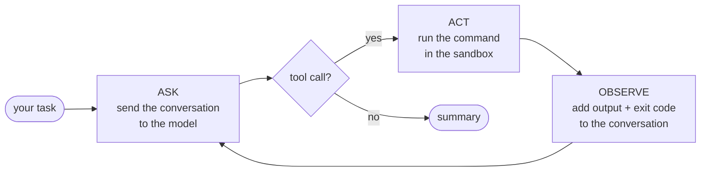

<p align="center"></p>

<h1 align="center">TINA</h1>

<p align="center"><b>Your Tiny AI Coding Agent</b><br>
<i>Tiny by name. Sandboxed by default.</i><br>
A real AI coding agent in ~60 lines of JavaScript. No framework, no dependencies.</p>

<p align="center">
  <a href="https://github.com/nchandupatla/tina-agent/actions/workflows/ci.yml"></a>
  <a href="LICENSE"></a>
  
  
</p>

---

TINA is **not** an AI model. It's the part around the model: the model is the brain,
and TINA gives it hands. It hands an existing model (Claude, or any OpenAI-compatible
model) one tool, a shell inside a locked Docker sandbox, and loops:

```
ASK → ACT → OBSERVE → REPEAT
```

TINA asks the model what to do, runs the command it picks, sends the output (errors
included) back to the model, and repeats until the job is done.

## Quickstart

You need **Node 20.12+**, **Docker** and an [OpenRouter](https://openrouter.ai) API key.
macOS and Linux work out of the box. On Windows, use WSL2.

```bash
git clone https://github.com/nchandupatla/tina-agent.git
cd tina-agent
cp .env.example .env        # put your key in TINA_API_KEY
npm link                    # adds the `tina` command to your PATH

mkdir ~/tina-playground && cd ~/tina-playground
tina                        # start a session
```

Or give it one task and let it run:

```bash
tina "build a tiny todo app in index.html and make sure it works"
```

The first run builds the sandbox image, which takes about 30 seconds. TINA works in
the folder you start it from. It won't start in your home folder or in its own folder.

## Using it

| In a session | What it does |
|---|---|
| `/model` | List the available brains |
| `/model free` | Switch brains mid-session. Presets: `haiku`, `sonnet`, `free`, `cheap`, or any OpenRouter model ID |
| `/cost` | Tokens, cache hit rate and spend so far |
| `/clear` | Forget the conversation |
| `/sandbox` | Show what TINA can and can't touch |
| `ctrl-c` | Quit |

| Setting (`.env`) | Default | What it does |
|---|---|---|
| `TINA_API_KEY` | — | Your OpenRouter key (required) |
| `TINA_MODEL` | `haiku` | A preset from [`models.json`](models.json) or any model ID |
| `TINA_BASE_URL` | OpenRouter | Any OpenAI-compatible endpoint with tool calling |
| `TINA_MAX_STEPS` | `30` | The most steps TINA takes before stopping |
| `TINA_CMD_TIMEOUT` | `60` | Seconds before a command is killed |
| `TINA_NET` | `0` | Set to `1` to give the sandbox network access |
| `TINA_CACHE` | `1` | Set to `0` to turn off prompt caching |

## How it works



The repo is laid out as a short course. Each file adds one idea:

| File | Idea | |
|---|---|---|
| [`01-ask.js`](01-ask.js) | **Model.** One API call. The model writes code, but nothing gets saved or run. | 12 lines |
| [`02-chat.js`](02-chat.js) | **Memory.** The model is stateless. It "remembers" because we resend the whole conversation. | 23 lines |
| [`tina.js`](tina.js) | **Agent.** A `bash` tool, the loop, the sandbox, limits and retries. | ~60 lines |
| [`prompts/system.md`](prompts/system.md) | The system prompt. Plain text, edit it freely. | |
| [`ui.js`](ui.js) | The terminal interface. Delete it and `node tina.js "task"` still works. | |

Line counts skip blank lines and comments, the same way the original Bash version
was counted. Check them with `npm run lines`.

**Prompt caching.** An agent resends its whole history on every step, so most of the
bill is the model re-reading what it already saw. TINA turns on prompt caching, so
that re-read history is billed at about a tenth of the normal input price on models
that support it, such as Claude. It's one line in `tina.js`.

## Safety

TINA runs commands written by an AI. Every command runs in a throwaway Docker
container with:

- **only your project folder** mounted, at `/workspace`
- **no network** (unless `TINA_NET=1`)
- **no secrets**: your API key stays in the host process and never enters the container
- a read-only root filesystem, all Linux capabilities dropped, and memory and process limits
- a timeout on every command and a cap on the number of steps

A container is not a perfect security boundary, and anything inside your project
folder, including `.env` files, is visible to the model. Read [SECURITY.md](SECURITY.md)
and don't point TINA at anything you can't afford to lose.

## What TINA is not

TINA is a small, readable agent for learning and experimenting. It has one tool, no
context compaction, no persistent memory and no plugins. It is not a replacement for
Claude Code, Codex or other production coding agents. The gap between them is the
interesting part.

## TINA vs Claude Code

[`bench/`](bench) holds the exact challenge prompt and scripts from the video.
`bench/race.sh haiku` runs both agents on the same model, through the same OpenRouter
key, in the same sandbox image, with network access and the same 20-minute limit.
Cost is measured the same way for both: OpenRouter spend before and after each run.

## Development

```bash
npm test           # fake model + real sandbox, no API key needed
npm run lines      # line counts
```

Contributions are welcome. See [CONTRIBUTING.md](CONTRIBUTING.md). The one rule is
that `tina.js` stays tiny.

## Credits

Inspired by [antonum/bash-harness](https://github.com/antonum/bash-harness) and its
[walkthrough](https://dev.to/antonum/minimalistic-ai-harness-in-62-lines-of-bash-script-170m),
a minimal AI harness in 62 lines of Bash (MIT). TINA is an independent JavaScript
implementation of the same idea.

TINA is not affiliated with or endorsed by Anthropic, OpenAI or OpenRouter. "Claude"
and "Claude Code" are trademarks of Anthropic. Claude Code, used only by the
benchmark scripts, is distributed under its own license.

## License

[MIT](LICENSE) © 2026 Naveen Chandupatla
